  

## About me

I'm a curious, driven Computer Science student who loves building things, exploring tech and solving real-world problems through code.

- 🔐 Currently going deep into **Cybersecurity** while growing my **Full-Stack Development** skills
- 🌱 Learning through **Coursera**, building projects and sharpening my problem-solving
- 📬 Email me at **sushantkumaryadav912@gmail.com**
- 🌐 Connect with me on [**LinkedIn**](https://www.linkedin.com/in/sushantkumaryadav)

---

## Featured projects

<!--
  Add your 3–4 best projects here. Only list real projects with working links. Template:

  | Project | What it solves | Tech | Links |
  |---|---|---|---|
  | **Project name** | One-line problem statement | React, Node.js, MongoDB | [Repo](https://github.com/sushantkumaryadav912/REPO) · [Demo](https://...) |
-->

_Selected projects are coming soon. Browse my [repositories](https://github.com/sushantkumaryadav912?tab=repositories) in the meantime._

---

## Tech stack

**Languages** 
        

**Frameworks & Libraries** 
           

**Databases** 
     

**Data Science & ML** 
   

**Cloud & DevOps** 
     

**Tools & Platforms** 
                

---

## Contribution activity

  

<!-- CONTRIBUTIONS_START -->
Loading contribution summary from `contributions.json`...
<!-- CONTRIBUTIONS_END -->

---

## GitHub stats

  
  

  

---

## Blog

Blog posts on tech and coding adventures are on the way. Follow along on [Dev.to](https://dev.to/sushantkryadav) and [Medium](https://medium.com/@sushantkumaryadav912).

---

## Find me online

  &nbsp;
  &nbsp;
  &nbsp;
  &nbsp;
  &nbsp;
  &nbsp;
  &nbsp;
  &nbsp;
  &nbsp;
  &nbsp;
  &nbsp;
  &nbsp;
  &nbsp;
  &nbsp;

---

> “I never lose. I either win or learn.” — Nelson Mandela

  

